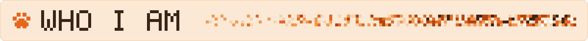
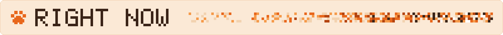
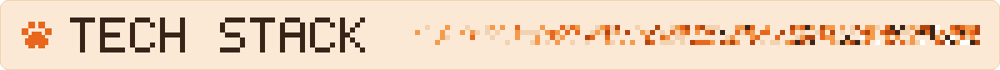
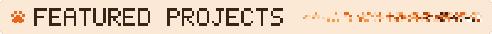
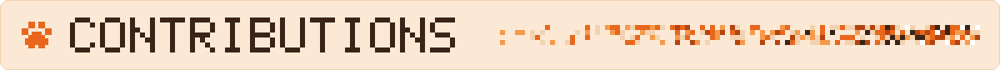
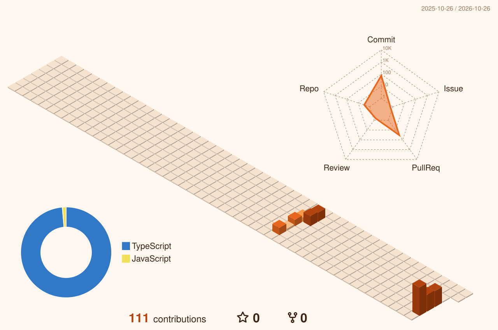
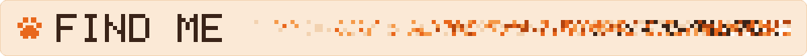

<picture>
  <source media="(prefers-color-scheme: dark)" srcset="assets/banner-dark.svg">
  
</picture>

<picture>
  <source media="(prefers-color-scheme: dark)" srcset="assets/section-about-dark.svg">
  
</picture>

Hey, I'm **Ethan** 🦊 — a junior developer living somewhere between **video games** and **the web**.
I started out building gameplay systems in **Unity / C#** (inventories, day–night cycles, platformers, game jams)
and now spend most of my days shipping **web tools that people actually use**: React front-ends, Go services,
Python bots and Postgres databases.

I like small, sharp tools, readable code, and anything with a bit of pixel art in it.

<picture>
  <source media="(prefers-color-scheme: dark)" srcset="assets/section-now-dark.svg">
  
</picture>

- 🏭 Building an **internal console** for a second-hand clothing warehouse — React 19, Supabase, Go & Python services
- 🎪 Crafting **[do-verlay](https://github.com/lerouxblond/do-verlay)**, a modular Dofus stream overlay driven live by Twitch chat
- 🎮 Prototyping small **Unity** games and joining game jams whenever I can
- 🌱 Learning: Go concurrency, real-time sync, and making UIs feel *alive*

<picture>
  <source media="(prefers-color-scheme: dark)" srcset="assets/section-stack-dark.svg">
  
</picture>

<table align="center">
  <tr>
    <td align="center" width="50%"><b>🎮 Game</b></td>
    <td align="center" width="50%"><b>🌐 Web & tools</b></td>
  </tr>
  <tr>
    <td align="center">
      <picture>
        <source media="(prefers-color-scheme: dark)" srcset="https://skillicons.dev/icons?i=unity%2Ccs%2Cdotnet%2Csqlite&theme=dark&perline=4">
        
      </picture>
    </td>
    <td align="center">
      <picture>
        <source media="(prefers-color-scheme: dark)" srcset="https://skillicons.dev/icons?i=react%2Cts%2Cvite%2Cgo%2Cpy%2Csupabase%2Cpostgres%2Cgit&theme=dark&perline=4">
        
      </picture>
    </td>
  </tr>
</table>

<picture>
  <source media="(prefers-color-scheme: dark)" srcset="assets/section-projects-dark.svg">
  
</picture>

<table>
  <tr>
    <td width="50%" valign="top">
      <h3><a href="https://github.com/lerouxblond/do-verlay">🎪 do-verlay</a></h3>
      Modular Dofus stream overlay + control panel. Modules are triggered live by Twitch chat commands.  
      <code>React</code> <code>TypeScript</code> <code>Go</code> <code>WebSocket</code>
    </td>
    <td width="50%" valign="top">
      <h3><a href="https://github.com/lerouxblond/Eurekalendar">📅 Eurekalendar</a></h3>
      Discord bot for schedules, tasks and team workflows.  
      <code>Python</code> <code>Discord</code>
    </td>
  </tr>
  <tr>
    <td width="50%" valign="top">
      <h3><a href="https://github.com/lerouxblond/universal_inventory_project">🎒 Universal Game System</a></h3>
      Reusable Unity inventory, health and item systems built on ScriptableObjects and MVC.  
      <code>Unity</code> <code>C#</code>
    </td>
    <td width="50%" valign="top">
      <h3><a href="https://github.com/lerouxblond/GameLauncher">🕹️ GameLauncher</a></h3>
      Desktop game launcher with accounts, a personal library, ratings and reviews.  
      <code>C#</code> <code>.NET WinForms</code> <code>EF Core</code> <code>SQLite</code>
    </td>
  </tr>
  <tr>
    <td width="50%" valign="top">
      <h3><a href="https://github.com/lerouxblond/platformer_2d">🏃 Platformer 2D</a></h3>
      Unity 2D platformer: movement, pass-through platforms, bounded camera, hazards.  
      <code>Unity</code> <code>C#</code>
    </td>
    <td width="50%" valign="top">
      <h3><a href="https://github.com/lerouxblond/RolexClickerGJ">⌚ Rolex Clicker</a></h3>
      Game jam entry — a clicker made against the clock.  
      <code>Unity</code> <code>C#</code> <code>Game Jam</code>
    </td>
  </tr>
</table>

<picture>
  <source media="(prefers-color-scheme: dark)" srcset="assets/section-stats-dark.svg">
  
</picture>

<picture>
  <source media="(prefers-color-scheme: dark)" srcset="profile-3d-contrib/profile-fox-dark.svg">
  
</picture>

<picture>
  <source media="(prefers-color-scheme: dark)" srcset="https://raw.githubusercontent.com/lerouxblond/lerouxblond/output/github-snake-dark.svg">
  
</picture>

<picture>
  <source media="(prefers-color-scheme: dark)" srcset="assets/divider-dark.svg">
  
</picture>

<picture>
  <source media="(prefers-color-scheme: dark)" srcset="assets/section-contact-dark.svg">
  
</picture>

<!-- Décommenter et compléter si tu veux les afficher :

-->

  

<picture>
  <source media="(prefers-color-scheme: dark)" srcset="assets/footer-dark.svg">
  
</picture>

